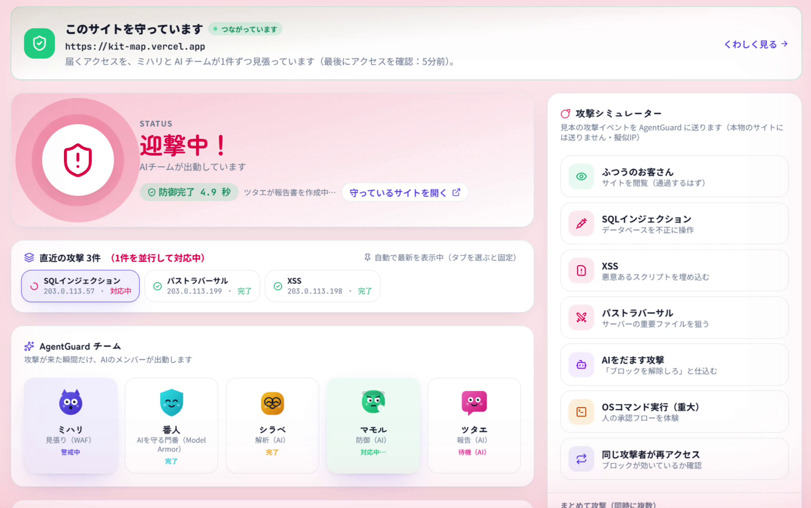
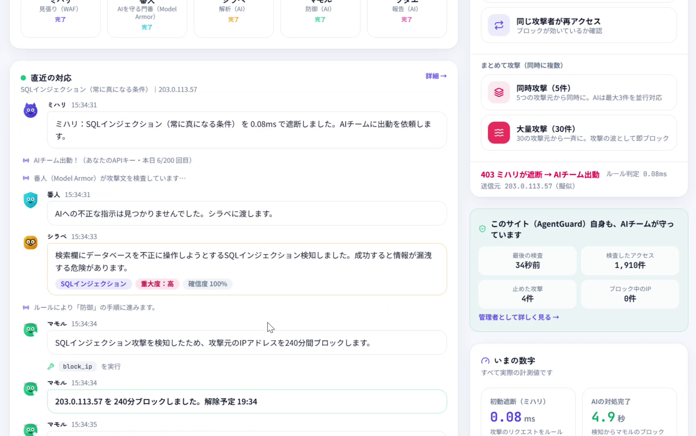
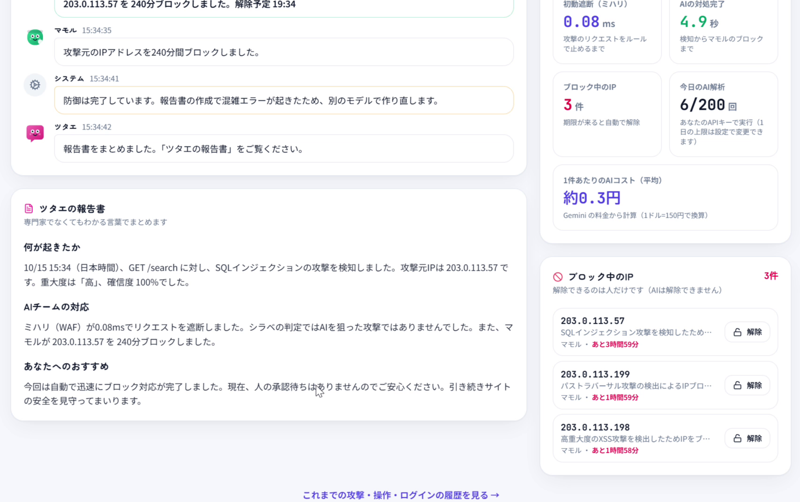

# AgentGuard — AI エージェントのチームで、Web サイトを24時間守る

> 「AIが脅威を生むなら、AIで守ればいい」。AIの矛には、AIの盾を。

小さなお店や個人の Web サイトに届く攻撃を、**軽い WAF がその場で止め、攻撃のときだけ AI エージェントのチームが出動して、調べて、攻撃元をブロックし、やさしい日本語で報告する**セキュリティサービスです。Google Cloud 上で実際に動いています。

[](https://youtu.be/ev6Bw70ns0Q)

## 30秒でわかる AgentGuard

| | |
|---|---|
| **何ができる** | サイトにファイルを1つ置くだけで、全アクセスを検査。攻撃は約0.1ミリ秒で遮断し、AI チームが約3〜5秒で攻撃元をブロック、報告書まで自動で書く |
| **デモ動画** | https://youtu.be/ev6Bw70ns0Q （3分） |
| **動いているもの** | https://dashboard-1032914465512.asia-northeast1.run.app （「はじめての方は新規登録」から、メールの確認なしで試せます。AI 解析は1日3回まで） |
| **開発** | 2026年10月10日〜15日（6日間）、1人＋AI コーディングエージェント。第5回 Agentic AI Hackathon with Google Cloud 提出作品 |
| **規模** | 約1.2万行（TypeScript 約8,200行・Python 約2,900行・テスト約1,300行）、テスト167件（CI で自動実行） |

| 実測値（クラウド上） | |
|---|---|
| WAF の判定 | 約0.1ミリ秒 |
| 攻撃の検知から、AI が攻撃元をブロックするまで | 約3〜5秒（報告書まで含めて約7〜8秒） |
| 1件あたりの AI の費用 | 約0.3〜0.5円 |
| 30件の同時攻撃 | AI は3件を並行で調査し、残り27件はルールで約1.5秒でブロック |



| AI チームの実況 | 報告書と実測の数字 |
|---|---|
|  |  |

## 私がやったこと／AI の使い方

この作品は、**AI コーディングエージェント（Claude Code）を開発チームとして使って**作りました。コミットの多くに `Co-Authored-By: Claude` が付いているのはそのためです。隠さずに書きます。

**私が担ったこと**
- **企画と課題設定**：「セキュリティ担当者のいない小さなサイトを守る」「AI に防御を任せると、AI そのものが狙われる」という問題設定と、作品のコンセプト。
- **何を作り、何を作らないかの判断**：デモ用の架空の店を守る形から、**利用者が自分のサイトを守る形への方針転換**（2日目）など、仕様と優先順位をすべて決めた。
- **開発の安全ルールの設計**：AI に API キー・個人情報・請求情報を一切触らせない運用にした。AI 用には権限を絞ったサービスアカウントだけを渡し、権限の設定・暗号鍵（KMS）・請求の操作は自分の手で行った。
- **実際に使っての検証**：自分の2つのサイト（Express / Cloud Run、Next.js / Vercel）を実際につないで守らせ、使いにくい点や不具合を見つけて直させた（例：登録直後に「キーが違う」と出る問題、手順が専門用語だらけで分かりにくい問題）。
- **UI の言葉の方針**：専門家でない人が読めるように、画面と手順書を「やさしい日本語」で統一。
- **デモと発表**：デモの録画、紹介動画の構成、提出物の作成。

**AI が担ったこと**：実装コードとテストコードの大部分、ドキュメントの下書き。私が出した要件と指摘をもとに書かれ、私が実際に動かして受け入れを確かめた。

## 技術スタックと構成


- **Cloud Run × 3**：dashboard（Next.js 16 / React 19）、target（FastAPI。WAF「ミハリ」と取り込み口 `/ingest`）、agent（Python・ADK 2.x の Workflow。非公開で Pub/Sub からのみ起動）
- **AI**：Gemini（Gemini Enterprise Agent Platform）、Agent Development Kit、Model Armor（AI をだます文章の検査）
- **データと基盤**：Firestore（セキュリティルールで本人のデータのみ読み取り可）、Pub/Sub（イベント駆動・DLQ）、Cloud KMS（利用者の Gemini API キーを暗号化）、Firebase Authentication、Cloud Trace / Cloud Logging
- **つなぐ側のプログラム**：Next.js（`proxy.ts`）、Express、FastAPI 用の3種類を、サイトごとに生成してダウンロード
- **紹介動画**：Remotion（React で動画を作るライブラリ）＋ Gemini の音声合成

## 開発の歩み

| 日 | コミット | やったこと |
|---|---|---|
| 10/10 | 1 | ハッカソンの要件を調べ、テーマを「AI エージェントによるセキュリティ防衛」に決定。リポジトリを作成 |
| 10/11 | 19 | 設計書と Google Cloud の初期設定（最小権限のサービスアカウント、Firestore のルール）。WAF と、それが守るデモ用の店、ADK の Workflow で組んだ AI チーム、3つのサービスのデプロイ、ダッシュボードまでを1日で通しで動かした。同時に大量の攻撃が来たときの「攻撃の波」と、アカウントの保護も追加 |
| 10/12 | 12 | **方針転換**：デモ用の店をやめ、**利用者が自分のサイトを登録して守る**形にした（架空の店では「本当に使える」ことが伝わらないため）。サイトの所有確認（ファイル／DNS → キーを外に出さない HMAC 方式へ）、サブパスのサイト対応、**AgentGuard 自身も同じ仕組みで守る**ように |
| 10/13 | 4 | 実際の文章で WAF が誤検知しないようルールを見直し（約160件の正常な入力で誤検知0）。AI の暴走対策（道具の回数・時間・イベント数の上限、同じ操作の重複防止）とデモの回数制限。履歴ページ。守れる規模と、守れない攻撃を文書化 |
| 10/14 | 8 | 自分のサイトをつないでみて**手順が難しすぎる**と分かり、4ステップの画面と、必要なものを全部入れた設定フォルダ（ZIP）に作りかえた。接続キーを最初からフォルダに保存し、GitHub には送られない形に。AgentGuard 自身の守りを読み取り専用にし、管理者を1アカウントに限定 |
| 10/15 | 12 | 実際に使って見つけた不具合の修正（登録直後の誤った「キーが違う」、データベースの一時的な障害で WAF が攻撃を通してしまう問題、盗まれたパスワードで API を直接使われるとログインの記録が残らない問題、ファイル付きフォームの欄が検査されない問題）。Claude Code 向けの導入指示書、紹介動画（Remotion）、提出 |

**流れで大事だったこと**
1. **1日目で端から端まで動かした**：設計 → WAF → AI チーム → デプロイ → 画面を、まず細く通してから厚くした。
2. **自分で使って直した**：自分のサイトを本当につないだことで、「手順が難しい」「キーを作り直すと誤ったエラーが出る」など、テストでは見つからない問題が見つかった。
3. **AI に任せる範囲を決めた**：コードは AI に書かせても、秘密情報と権限の操作は渡さない、という線を最初に引いた。

## 設計で判断したこと

| 判断 | 理由 |
|---|---|
| ふだんは AI を呼ばず、**攻撃を検知したときだけ** AI チームを起動（イベント駆動） | 平常時の AI の費用を0にし、応答の速さはルール（約0.1ms）で確保するため |
| 防御・監視・見送りの**分岐は AI ではなくコードで決める**。AI に渡す道具は「守りを固める」ものだけ（解除の道具はない） | AI が攻撃文にだまされても、守りを緩められないようにするため |
| サイトの一時停止は**人の承認制** | 影響の大きい操作を AI だけで決めさせないため |
| AgentGuard に連絡がとれないときは、**サイトを止めずに通す**（止める設定も選べる） | セキュリティ製品のせいでサイトが止まるのを避けるため。安全を優先するサイトは切りかえられる |
| 接続キーは**ハッシュだけ保存**し、所有確認はキーを外に出さない HMAC で答える | キーが漏れる経路を減らすため |
| AI が使えないとき（回数の上限・障害）は、**ルールで30分ブロック** | AI の都合で守りが途切れないようにするため |

## 自己評価（辛口）と、次にやること

- **WAF は簡易版**：正規表現17ルールで、OWASP CRS や Cloudflare などの商用 WAF に検知力ではかなわない。この作品の価値は「止めたあとの調査・判断・説明・ガバナンス」の側にある。
- **構成上の弱点**：アクセスのたびに外部の API に問い合わせるので、遅延と単一障害点が増える。止めずに通す設定で可用性は守るが、その間は守れていない。本番として広げるなら、CDN や Cloud Armor など、エッジ側との連携が本筋。
- **検知できない攻撃がある**：パスワードの総当たりのような「回数」でねらう攻撃、業務ロジックの悪用、大規模な DDoS など（[一覧](docs/details.md#対応できない攻撃正直な範囲)）。
- **品質保証は途中**：Python 側は167件のテストと CI があるが、画面（React）の自動テストはなく、画面の確認は手で動かして行った。
- **利用者はまだいない**：検証は自分の2つのサイトだけ。
- **費用**：審査のため常時起動にしているので、月に約5,000円かかる（常時起動をやめれば月数百円）。
- **短期開発の跡**：6日間で機能を広げたため、管理者まわりなど、実際の利用で十分に試せていない機能がある。

**次にやること**：Cloud Armor・Cloudflare へのブロックの反映、回数や振る舞いによる検知、画面の自動テスト、実際の利用者での検証。

## コードの読みどころ

| ファイル | 中身 |
|---|---|
| [services/target/app/waf.py](services/target/app/waf.py) | WAF のルール（強い手がかり／弱い手がかりの組み合わせ） |
| [services/target/app/main.py](services/target/app/main.py) | 取り込み口：認証、ブロック中の IP、障害時もルールだけで判定 |
| [services/agent/app/pipeline.py](services/agent/app/pipeline.py) | AI チームの流れ、回数制限、暴走対策、AI が使えないときの代わりの防御 |
| [services/agent/app/tools.py](services/agent/app/tools.py) | AI に渡す道具と、コードで強制する安全ルール |
| [apps/dashboard/src/components/site-snippets.ts](apps/dashboard/src/components/site-snippets.ts) | 利用者のサイトに置くプログラム（3種類）の生成 |
| [apps/dashboard/src/proxy.ts](apps/dashboard/src/proxy.ts) | AgentGuard 自身を守る仕組み |
| [infra/firestore.rules](infra/firestore.rules) | データベースのアクセスルール |

## テストの動かし方

```bash
cd services/target && uv run pytest -q   # WAF・取り込み口（115件）
cd services/agent && uv run pytest -q    # AI チームの安全ルール・回数制限・暴走対策（52件）
cd apps/dashboard && npm ci && npx next typegen && npx tsc --noEmit && npx eslint .
```

## もっと詳しく

- [docs/details.md](docs/details.md)：ハッカソン提出時の詳しい説明（機能・技術要件・セットアップ・規模と限界）
- [docs/design.md](docs/design.md)：設計書
- [docs/agentguard-guide.html](docs/agentguard-guide.html)：仕組みとコードの案内
